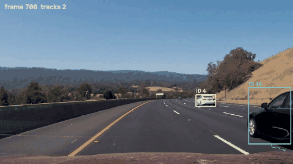

# Multi-Object Tracking: SORT (Kalman filter + Hungarian algorithm)

Gives every detected vehicle a **persistent ID** across video frames. Detections come from a pretrained YOLO
model; the tracker predicts each object's next box with a Kalman filter and assigns detections to tracks with
the Hungarian algorithm on IoU. Evaluated with the standard MOT metrics (MOTA, IDF1, ID switches) against a
baseline without a motion model.



## Results

### Controlled evaluation on simulated scenes

Real tracking benchmarks (MOT17, KITTI tracking) are several GB, so the trackers are measured on generated
scenes with exact ground truth: 20 scenes × 300 frames × 12 car-sized objects crossing the image in both
directions; the detector has 4 px box noise, 10% missed detections, random 3–7-frame occlusions and
0.5 false positives per frame. Metrics computed with [py-motmetrics](https://github.com/cheind/py-motmetrics).
`max_age` 5, `min_hits` 3, IoU threshold 0.3 for all trackers.

| Scene | Tracker | MOTA ↑ | IDF1 ↑ | ID switches ↓ | False pos. | Misses |
|---|---|---|---|---|---|---|
| normal speed (3–10 px/frame) | IoU baseline (no motion model) | 0.818 | 0.674 | 321 | 36 | 8,038 |
| | SORT | 0.821 | 0.696 | 275 | 27 | 7,969 |
| | IoU baseline + coasting | 0.921 | 0.709 | 321 | 1,050 | 2,280 |
| | **SORT + coasting** | **0.941** | **0.736** | **275** | 619 | 1,820 |
| fast (15–30 px/frame) | IoU baseline | 0.706 | 0.573 | 521 | 38 | 3,930 |
| | SORT | 0.799 | 0.830 | **76** | 28 | 2,953 |
| | IoU baseline + coasting | 0.562 | 0.535 | 525 | 3,337 | 2,819 |
| | **SORT + coasting** | **0.855** | **0.855** | **76** | 1,142 | 992 |

What the numbers say:

- **Slow objects:** the last box still overlaps the new one, so the motion model barely matters (MOTA 0.818 → 0.821).
- **Fast objects:** the Kalman prediction is where the object *will be*; ID switches drop from 521 to 76 (−85%)
  and IDF1 rises from 0.57 to 0.83.
- **Coasting** (reporting the predicted box for up to `max_age` frames without a detection) fills gaps from
  missed detections and occlusions — but only if the prediction is good: with stale boxes (baseline) it adds
  3,337 false positives and MOTA *drops* to 0.56; with Kalman predictions MOTA rises to 0.855.

MOTA = 1 − (misses + false positives + ID switches) / ground-truth objects; IDF1 = how long each true object
keeps one ID.

### Real video (YOLO11n detections, 1,260 frames)

| Measure | Value |
|---|---|
| Tracks confirmed and shown | 34 (72 IDs started; the rest were single-frame detections removed by `min_hits`) |
| Tracks longer than 1 s | 12 |
| Longest track | 693 frames (28 s, one car keeps the same ID) |
| Time per frame | YOLO 103 ms, **SORT 0.67 ms** (tracking is ~150× cheaper than detection) |

There is no ground truth for this video, so these are descriptive numbers, not accuracy.

## How it works

| Part | File | Details |
|---|---|---|
| Kalman filter per box | `mot/kalman_box.py` | state (cx, cy, area, aspect ratio, v_cx, v_cy, v_area); constant velocity; aspect ratio assumed constant; new tracks start with large velocity variance |
| Association | `mot/association.py` | IoU matrix between detections and *predicted* boxes → `scipy.optimize.linear_sum_assignment` (Hungarian, globally optimal, O(n³)); pairs below IoU 0.3 rejected |
| Track management | `mot/trackers.py` | unmatched detection → new track; track deleted after `max_age` frames without a match; shown only after `min_hits` matches (suppresses false positives) |
| Baseline | `mot/trackers.py` | identical, but the "prediction" is the last observed box |
| Simulation | `mot/synthetic.py` | scenes with ground truth and an imperfect detector |

## Run

```bash
pip install -r requirements.txt
python evaluate_synthetic.py --scenes 20                    # writes results/synthetic.json
curl -L -o data/project_video.mp4 https://raw.githubusercontent.com/udacity/CarND-Advanced-Lane-Lines/master/project_video.mp4
python track_video.py --input data/project_video.mp4 --output output/tracked.mp4
pytest -q
```

## Tests

`tests/test_mot.py`: IoU values; the Hungarian assignment finds the optimal pairing where greedy matching
would not; box ↔ state conversion; an ID survives a 3-frame gap and the coasting box moves with the object;
after 2 missed detections SORT keeps the ID while the baseline starts a new one; `min_hits` hides a one-frame
false positive; and a documented limitation (below).

## Limitations

- A new track starts with zero velocity: an object moving almost a box width per frame is never matched and
  gets a new ID every frame (covered by a test). Lower frame rates make this worse.
- IoU-only matching cannot re-identify an object after a long occlusion; DeepSORT adds an appearance
  embedding for that, ByteTrack also matches low-confidence detections.
- The simulation is a controlled test of the tracking logic, not a substitute for a real benchmark; the next
  step is MOT17 or KITTI tracking with official ground truth.

## Credits

SORT: A. Bewley et al., *Simple Online and Realtime Tracking*, ICIP 2016 (this is an independent
implementation). Video: [udacity/CarND-Advanced-Lane-Lines](https://github.com/udacity/CarND-Advanced-Lane-Lines), MIT License.
Detector: [Ultralytics YOLO](https://github.com/ultralytics/ultralytics), AGPL-3.0 — this project is therefore AGPL-3.0.
